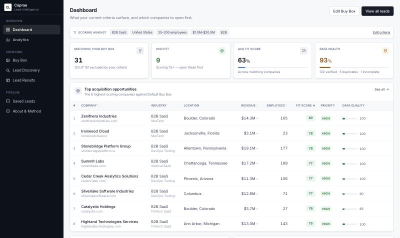
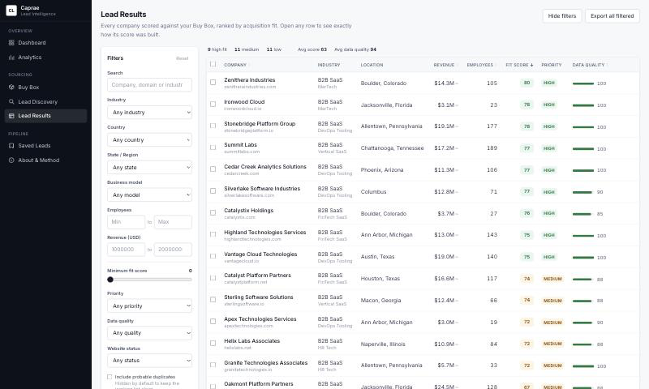
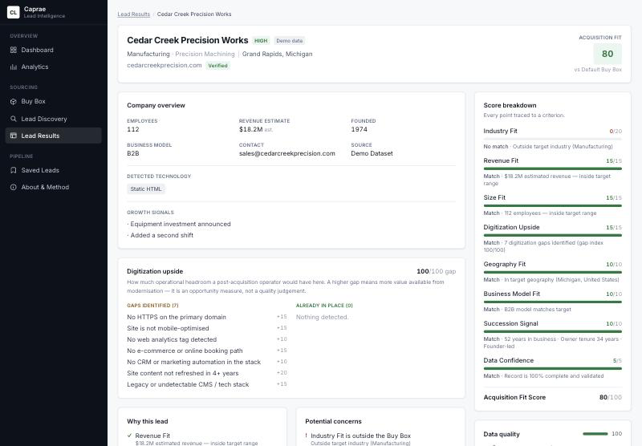
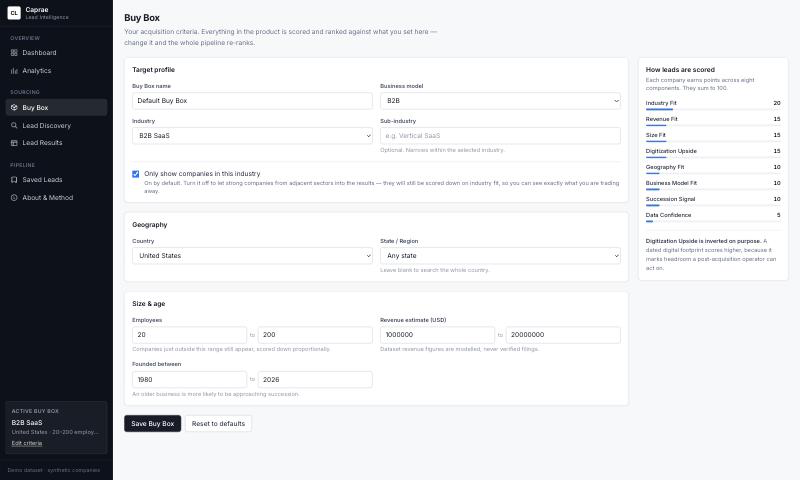
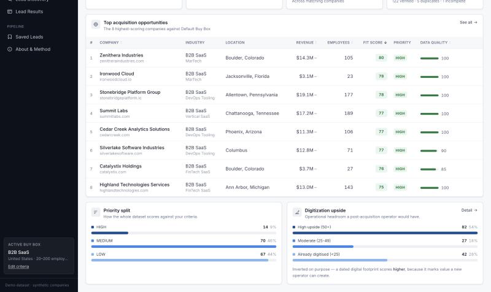
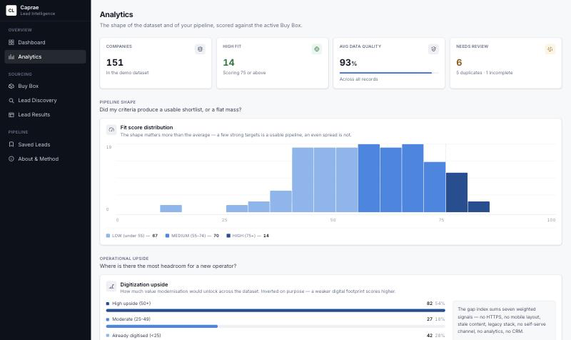

# Caprae Lead Intelligence

**An acquisition-fit scoring layer for deal sourcing.** Takes a list of companies and answers the
question a lead-generation tool leaves unanswered: *which of these should I look at first, and why?*

Built as pre-work for the Caprae Capital Full Stack Developer role. MERN stack, runs locally,
~5 hours of engineering on the core features.

---

## The business problem

Lead generation tools return hundreds of companies. For a searcher practising entrepreneurship
through acquisition (ETA), that list is not an answer — it is the start of several hours of manual
research to work out which handful are worth a conversation.

The bottleneck is not **finding** companies. It is **judging** them.

So this tool does not scrape. It sits on top of a company list and re-ranks it against the
searcher's own acquisition criteria, showing its working at every step.

```
   WITHOUT                           WITH
   ─────────                         ─────────
   151 companies                     151 companies
        ↓                                 ↓
   open each one                     Buy Box criteria
        ↓                                 ↓
   check size, sector,               automated validation + deduplication
   owner, website                          ↓
        ↓                            explainable fit scoring
   hours of research                       ↓
        ↓                            14 HIGH-fit targets, ranked
   a shortlist                             ↓
                                      a shortlist — in seconds
```

---

## The two features, and why these two

The brief asks for one or two impactful features rather than a broad clone. These are the two.

### 1. Explainable Acquisition Fit Score

Every company is scored 0–100 against a configurable **Buy Box**. Eight weighted components,
summing to exactly 100:

| Component | Weight | What it measures |
|---|---:|---|
| Industry Fit | 20 | Sector match, with partial credit for adjacent sectors |
| Revenue Fit | 15 | Estimated revenue against the target band |
| Size Fit | 15 | Headcount against the target band |
| **Digitization Upside** | 15 | **How much operational headroom modernisation would unlock** |
| Geography Fit | 10 | Country and state alignment |
| Business Model Fit | 10 | B2B / B2C / marketplace / services |
| **Succession Signal** | 10 | **Business age, owner tenure, founder-led, ownership independence** |
| Data Confidence | 5 | How complete and validated the underlying record is |

`HIGH ≥ 75 · MEDIUM 55–74 · LOW < 55`

**The score is never a black box.** Each component reports the points it earned, the points
available, and a sentence explaining the result. The component points always add up to the headline
number — there is a unit test that enforces it, because nothing destroys trust in a score faster
than arithmetic the user can see is wrong.

#### Digitization Upside — the component that is specific to this buyer

Seven other components reward a *closer* match. This one rewards a *worse* digital footprint, and
that inversion is the point.

If returns come from operational transformation after an acquisition rather than financial
engineering at it, then a profitable business still running on a non-mobile site with no analytics
and no self-serve channel is not a weaker target. It is one where a known playbook has somewhere to
be applied. The component measures the size of that opportunity, not the quality of the company.

It is computed from explicit weighted gaps — no HTTPS (15), not mobile-optimised (15), stale content
(20), legacy stack (15), no e-commerce or booking (15), no analytics (10), no CRM (10) — summed into
a 0–100 gap index. Stated as a list rather than a model output so a user can disagree with any one
signal and see exactly what it was worth.

### 2. Lead Quality & Data Health

A fit score is only as trustworthy as the record underneath it. Every company carries an independent
0–100 data-quality score built from eleven named checks (domain validity, website reachability,
location completeness, contact availability, duplicate status, and so on), each weighted by decision
impact rather than by field count.

**Deduplication** runs on normalised keys, not string equality:

```
https://www.example.com/   →  example.com
http://example.com         →  example.com
WWW.EXAMPLE.COM            →  example.com

"ABC Software, Inc."       →  abc software
"A.B.C. Software LLC"      →  abc software
```

Matching precedence is domain first (a domain is *owned*, so it is the strongest signal), then
normalised company name **plus country** — because "Apex Plumbing" in Texas and in Ontario are
different companies.

**Nothing is ever deleted.** The oldest record in a group is marked `primary`, the rest
`probable_duplicate`, each carrying the reason it matched and the record it matched against. Silently
deleting a record a searcher may already have acted on is a far worse failure than showing them a
flagged duplicate — and "probable" is an honest description of what a heuristic can actually claim.

---

## Screenshots

| | |
|---|---|
|  |  |
| **Dashboard** — active criteria, pipeline health, ranked opportunities | **Lead Results** — filter, sort, select, export |
|  |  |
| **Lead Detail** — every point of the score, plus concerns | **Buy Box** — criteria, with the scoring model visible |
|  |  |
| **Priority and digitization split** — one hue, ordinal ramp | **Analytics** — question-led groups, threshold-aligned histogram |

---

## Local setup

**Prerequisites:** Node.js 18+ and a local MongoDB server.

```bash
# macOS — install and start MongoDB if you do not have it
brew tap mongodb/brew && brew install mongodb-community
brew services start mongodb-community
```

```bash
# 1. Install dependencies for both workspaces
npm run install:all

# 2. Create the server env file
cp server/.env.example server/.env

# 3. Seed the demo dataset (151 companies)
npm run seed

# 4. Start the API  — http://localhost:5000
npm run dev:server

# 5. Start the UI in a second terminal — http://localhost:5173
npm run dev:client
```

Open **http://localhost:5173**. The app is usable immediately — a default Buy Box is created on
first load, so there is no setup step before you see scored leads.

```bash
npm test     # 76 unit tests over the business logic
```

### Environment variables

| Variable | Default | Purpose |
|---|---|---|
| `MONGO_URI` | `mongodb://127.0.0.1:27017/caprae_lead_intelligence` | Connection string. **No fallback in code** — a missing value is a hard boot failure, not a guess at another instance. |
| `PORT` | `5000` | API port |
| `NODE_ENV` | `development` | Enables request logging; suppresses error detail in production |
| `CORS_ORIGIN` | `http://localhost:5173` | Comma-separated allow-list |

`.env` is git-ignored. `.env.example` is committed with safe values.

### Database isolation

This project writes only to a database named **`caprae_lead_intelligence`**. The seed script
verifies the database name twice — once from the URI before connecting, once against what the driver
actually resolved — and aborts rather than writing if it does not match. It clears only the three
collections this project owns (`companies`, `buyboxes`, `savedleads`), and never calls
`dropDatabase()` or `collection.drop()`.

---

## Architecture

```
┌──────────────────────────────────────────────────────────┐
│  React 18 + TypeScript + Vite + Tailwind   (port 5173)   │
│  pages · components · charts · hooks · typed API client   │
└───────────────────────────┬──────────────────────────────┘
                            │  REST / JSON   (Vite proxies /api)
┌───────────────────────────▼──────────────────────────────┐
│  Express        routes → controllers → services           │
│                 (thin)    (thin)       (all logic)        │
│                                                           │
│   ┌─────────────┬──────────────┬───────────────────────┐ │
│   │  scoring    │  dedupe      │  dataQuality          │ │
│   │  leadQuery  │  analytics   │  export · buyBox      │ │
│   └─────────────┴──────────────┴───────────────────────┘ │
│   validation · normalisation · error handling · CSV       │
└───────────────────────────┬──────────────────────────────┘
                            │  Mongoose
┌───────────────────────────▼──────────────────────────────┐
│  MongoDB   caprae_lead_intelligence                       │
│            companies · buyboxes · savedleads              │
└──────────────────────────────────────────────────────────┘
```

**Services hold the business logic and are pure functions.** `scoreCompany(company, buyBox)` takes
two plain objects and returns a plain object — no database, no Express, no I/O. That is what makes
the scoring model directly unit-testable, and it is why the test suite covers the logic that matters
rather than the plumbing around it.

### Tech stack, and why

| Choice | Reasoning |
|---|---|
| **MongoDB** | Company records are sparse and heterogeneous — a SaaS company has a tech stack, an HVAC contractor has a franchise flag, and many fields are simply unknown. In a relational schema that is a wide table of nulls or a pile of joins. A document model stores what is known and omits what is not. The sub-documents (`digitalSignals`, `ownership`) are read as a unit with the parent and never queried independently, so embedding is correct here rather than convenient. |
| **Express** | The API surface is a dozen REST endpoints. A heavier framework would add structure this does not need. |
| **React + TypeScript** | The score breakdown is a non-trivial nested shape rendered in four places; types catch the mismatches that would otherwise be runtime bugs. |
| **Vite** | Fast dev server and a `/api` proxy, which keeps CORS out of local development entirely. |
| **Tailwind** | A constrained token set is what keeps a dense data UI visually consistent across eight pages. |
| **Node's built-in test runner** | 76 tests, zero test dependencies. |

### Database design

```js
companies      // normalizedDomain, normalizedCompanyName, digitalSignals,
               // ownership, duplicateStatus, duplicateGroupId, dataCompleteness
buyboxes       // criteria + per-Buy-Box score weights + industryStrict
savedleads     // company ref + score snapshot at save + note + pipeline status
```

**Indexes, and why each one:**

| Index | Justification |
|---|---|
| `normalizedDomain` | The deduplication lookup and the strongest identity key |
| `normalizedCompanyName` | Secondary dedupe signal |
| `{ industry: 1, 'location.country': 1 }` | Compound — the most common Buy Box prefilter, in that field order because industry is the more selective of the two |
| `employeeCount`, `revenueEstimate` | Back the range filters |
| `duplicateStatus`, `duplicateGroupId` | Duplicates are excluded from every default query, and groups are fetched on the detail page |
| `companyName` + `domain` text index | The free-text search box |

**Deliberately not indexed:** `businessModel` and `websiteStatus`. Both have three to six distinct
values across the collection. An index on a low-cardinality field is read-amplifying rather than
selective — MongoDB scans them more cheaply than it traverses a near-useless B-tree.

### Scores are computed, not stored

A fit score is a function of `(company, buyBox)`. The moment a searcher widens their revenue band,
every stored score is wrong.

Persisting them would mean a write amplification of N companies on every criteria change, plus a
staleness bug class that stays invisible until someone acts on a bad ranking. Computing on read is
correct by construction.

**The cost, stated honestly:** score-based filters and sorts cannot be pushed into MongoDB, so the
candidate set is scored in the application layer. At this dataset size that is a few milliseconds.
The scaling answer is in *Future improvements* below.

The one exception is `SavedLead.scoreAtSave`, which snapshots the score at the moment of saving —
a user who saved a lead at 91/100 wants to see what they decided on. The UI shows both values when
they differ.

### Performance

- **Frontend** — pagination; debounced free-text search (dropdowns apply immediately); filter state
  in the URL so a view is shareable and survives reload; route-level code splitting (Analytics,
  About, Buy Box and Lead Detail are separate chunks); a stale-response guard so a slow earlier
  request cannot overwrite a faster later one.
- **Backend** — `.lean()` on every read path, since the scoring layer never needs Mongoose documents
  and skipping hydration is the cheapest win available; compound indexes matched to real query
  shapes; pagination clamped server-side at 100 rows so a client cannot request the whole collection.
- **Caching is not implemented**, deliberately. At this size it would be complexity without a
  measurable gain. In production the thing worth caching is the scored result set per
  `(buyBoxId, filterHash)`, in Redis with a short TTL, invalidated on Buy Box write — which is a
  real cache with a real invalidation rule, rather than a TTL guess.

### Security

Environment-only configuration with no hard-coded fallback URI · `helmet` security headers · an
explicit CORS allow-list rather than `*` · request validation on every write path · `$regex` input
escaped before it reaches the query · rate limiting at 300 requests/minute · a 1 MB body cap ·
CSV formula-injection neutralised on export (a leading `=`, `+`, `-` or `@` is prefixed, because
exported data gets opened in Excel) · generic 500 messages so an unexpected exception cannot leak
internals · `.env` git-ignored.

No authentication: the brief rules it out, and adding it would consume budget without serving the
feature being evaluated. The schema is already per-user-ready — `buyboxes` and `savedleads` need an
owner field and a query scope, not a redesign.

---

## Deployment

> **Status: this build runs locally and is not currently hosted.** The handbook asks
> candidates to detail hosting setup, deployment process and cloud provider, so this
> section documents the target topology and the reasoning behind it. Every choice below
> is one I can operate, not one I picked because it sounded impressive.

### Topology

```
                     ┌─────────────────────────────┐
  browser  ────────► │  Vercel — static CDN        │   React build output
                     │  dist/ (HTML, JS, CSS)      │   no server, no SSR
                     └──────────────┬──────────────┘
                                    │  /api/*  rewritten to the origin
                                    ▼
                     ┌─────────────────────────────┐
                     │  Cloudflare — DNS + TLS     │   terminates HTTPS
                     └──────────────┬──────────────┘
                                    ▼
                     ┌─────────────────────────────┐
                     │  Ubuntu 22.04 VPS           │   DigitalOcean droplet
                     │  Node 18 · Express on :5000 │   long-lived process
                     │  MongoDB on localhost       │   bound to 127.0.0.1
                     └─────────────────────────────┘
```

| Component | Hosting model | Where | Why |
|---|---|---|---|
| Frontend | **Static** | Vercel | Vite emits a plain static bundle. There is no server-side rendering requirement and the tool sits behind a login in production, so SEO is irrelevant — a CDN-served bundle is the simplest correct answer. |
| API | **Long-lived server**, not serverless | Ubuntu VPS (DigitalOcean) | See the argument below. |
| Database | Self-hosted on the same box | MongoDB, bound to `127.0.0.1` | One moving part fewer at this size. Migration path is MongoDB Atlas — a connection-string change, since the app reads `MONGO_URI` from the environment and nothing else. |
| TLS / DNS | Managed edge | Cloudflare | Terminates HTTPS at the edge, so the origin stays a plain Node process. No reverse proxy to configure or keep patched. |

**Cloud provider: DigitalOcean** for compute, **Vercel** for the static frontend,
**Cloudflare** for DNS and TLS. Deliberately not AWS, GCP or Azure — see *What is
deliberately not here*.

### Why a VPS rather than serverless

This is the decision the handbook actually asks about, so here is the reasoning rather
than a preference.

1. **The scoring pass is CPU work over the whole candidate set.** Every search scores
   every company that survives the Mongo filter. On serverless that is per-invocation
   CPU billing for work whose cost scales with dataset size, plus a cold start in front
   of it. On one warm box it is a few milliseconds of an already-running process.
2. **The documented scaling path is a background job.** Materialising scores per saved
   Buy Box means a job that runs for minutes over the full collection. Function
   platforms cap execution at 10–15 minutes and are built around request/response —
   that is the wrong shape for the one optimisation this design is headed towards.
3. **The enrichment path is long-running by design.** Polite collection means honouring
   `robots.txt` and crawl-delay, which means a job that deliberately takes minutes. A
   timeout budget turns a correct, courteous crawler into a fight with the platform.
4. **Mongoose holds a connection pool.** A long-lived process keeps one pool warm.
   Serverless functions either re-establish connections on every cold start or need a
   connection proxy in front of the database — complexity bought to solve a problem the
   VPS does not have.
5. **Cost is predictable at the real usage shape.** An internal sourcing tool for a small
   deal team gets steady, modest traffic. A fixed small droplet costs less than
   per-invocation billing at that profile, and the first request of the morning is not
   paying a cold start.

**What would change my mind.** If traffic were genuinely spiky and rare — a few bursts a
week — serverless would win on cost and I would take the cold starts. If the team wanted
zero operational surface, I would move the API to a managed Node platform (Render,
Railway) and give up the shell access rather than pretend a VPS maintains itself. The
VPS is right for *this* workload, not right in general.

### How the frontend reaches the API

The client calls relative `/api/*` paths and never hard-codes a backend host. In
development Vite proxies them; in production a Vercel rewrite does the same job, which
keeps the browser on one origin and takes CORS out of the picture entirely:

```json
{
  "rewrites": [
    { "source": "/api/:path*", "destination": "https://api.example.com/api/:path*" }
  ]
}
```

No application code changes between local and deployed. That is the point of using
relative paths rather than a `VITE_API_BASE_URL` build variable.

### Release process

Frontend: push to the default branch. Vercel builds `client/` and promotes the static
output. Rollback is selecting the previous deployment.

API, over SSH:

```bash
ssh deploy@api.example.com

cd /srv/caprae-lead-intelligence
git pull --ff-only origin main        # 1. fetch the release
npm --prefix server ci --omit=dev     # 2. install exactly the lockfile
npm --prefix server test              # 3. gate: 76 tests must pass on the box
sudo service caprae-api restart       # 4. restart the service
journalctl -u caprae-api -n 50 -f     # 5. watch it come back up
curl -s localhost:5000/api/health     # 6. confirm DB name and connection state
```

Step 3 is the gate. The suite is pure business logic with no database dependency, so it
runs in about 300 ms on the server and catches a bad merge before the restart rather
than after it. Step 6 is why `/api/health` reports the resolved database name — a
deploy that silently connects to the wrong database is the failure mode worth checking
for explicitly.

**Rollback** is `git checkout <previous-tag>`, reinstall, restart — the same five steps
against a known-good commit. Releases are tagged so there is always a specific thing to
roll back to.

**Seeding is not part of the release.** `npm run seed` clears and rewrites the three
collections, so it runs once at provision time and never again automatically. The
database-name guard in `server/src/config/db.js` means a mistyped `MONGO_URI` aborts
rather than overwriting something else.

### Configuration and secrets

`MONGO_URI`, `PORT`, `NODE_ENV` and `CORS_ORIGIN` live in `server/.env` on the box,
readable only by the service user. Nothing is baked into the build. `.env` is
git-ignored and `.env.example` carries safe placeholders. The application fails at boot
with a clear message if `MONGO_URI` is absent — it never falls back to a default
connection string, because a silent fallback is how a process ends up writing to a
database nobody intended.

### Monitoring

Structured request logs with per-endpoint latency, read as p95 rather than mean.
MongoDB slow-query logging, with `explain()` on anything that regresses — the first
thing to degrade at scale is an index quietly ceasing to be selective. A scheduled
`GET /api/health` check that asserts `database.state === "connected"`, because an
endpoint returning `200` with an empty array is the failure that pages nobody.

### What is deliberately not here

No Docker, no Kubernetes, no CI/CD pipeline, no AWS/GCP/Azure services, no reverse
proxy of my own.

That is a scope decision, not an oversight. A container image and a pipeline are the
right call for a team shipping several times a day; for a single-service MVP deployed
by one person they are infrastructure to maintain in exchange for a problem that does
not exist yet. The release above is six commands and a test gate, and I can explain
every one of them.

The honest version of the trade-off: this setup has a single point of failure and
manual releases. The first things I would add, in order, are automated nightly database
backups off the box, a second droplet behind a load balancer, and only then a pipeline
to automate the six steps.

---

## API

All responses share one envelope, so the client has exactly one shape to handle:

```jsonc
{ "success": true,  "data": [...], "pagination": { "page": 1, "limit": 20, "total": 151 } }
{ "success": false, "error": { "message": "Employee count must be greater than or equal to 0" } }
```

| Method | Route | Purpose |
|---|---|---|
| `GET` | `/api/health` | Liveness + database state |
| `GET` | `/api/leads` | Scored, filtered, sorted, paginated leads |
| `POST` | `/api/leads/search` | Same, with filters in the body |
| `GET` | `/api/leads/:id` | Lead detail with full breakdown and duplicate group |
| `POST` | `/api/leads/:id/score` | Re-score one lead against the current Buy Box |
| `POST` | `/api/leads/:id/save` | Save to pipeline (upsert) |
| `POST` | `/api/leads` | Create a company (validated) |
| `GET` | `/api/leads/filters/options` | Distinct values for the filter dropdowns |
| `GET` `POST` `POST` | `/api/buy-box` · `/api/buy-box` · `/api/buy-box/reset` | Read, save, reset criteria |
| `GET` | `/api/buy-box/model` | The scoring weights and descriptions |
| `GET` `PATCH` `DELETE` | `/api/saved-leads` · `/api/saved-leads/:id` | Pipeline management |
| `GET` | `/api/analytics` · `/api/analytics/dashboard` | Distributions and headline counts |
| `GET` `POST` | `/api/export` | CSV of a selection or of the filtered set |

---

## Testing

```
76 tests · 0 dependencies · node --test
```

| File | Covers |
|---|---|
| `scoring.test.js` | Band fitting, each component, weight overrides, **that components sum to the total**, the digitization inversion, priority bands |
| `dedupe.test.js` | URL-format duplicates, name duplicates, same name across countries, shared website-builder hosts, primary selection, that nothing is deleted |
| `normalize.test.js` | Domain and company-name normalisation, subdomain preservation, email syntax |
| `validate.test.js` | Negative and non-integer rejection, `''` not coerced to `0`, range inversion, error aggregation |
| `dataQuality.test.js` | Check weighting, explanations on every failure, the un-deduplicated case |
| `leadQuery.test.js` | Filter construction, regex escaping, derived filters, null-sinking sort, immutability |

Two of these found real bugs while being written: `A.B.C. Software` normalised to `a b c software`
because periods were being treated as word separators, and the duplicate check was passing records
deduplication had never run on.

---

## Known limitations

Stated plainly, because a reviewer will find them anyway:

- **Name deduplication is exact-match on the normalised key, not fuzzy.** "Ironwood Mechanical
  Services" and "Ironwood Mechanical" normalise differently and stay separate records. Trigram or
  edit-distance matching would catch that pair — and would also start merging genuinely distinct
  companies with similar names. For a tool whose output feeds an acquisition decision, I took the
  false-negative over the false-positive. The honest fix is a confidence score on the match plus a
  review queue, not a looser threshold.
- **Score-based filters and sorts run in the application layer**, not in MongoDB. Correct, and fine
  at this size; the materialisation path is described above.
- **No integration tests over the HTTP layer.** The business logic is well covered; the routes are
  covered by hand. That is the first gap I would close.
- **The digitization gap weights are judgement calls**, not measurements. They are listed explicitly
  in `scoring.config.js` precisely so they can be argued with.

---

## Trade-offs

| Decision | Alternative | Why this one |
|---|---|---|
| Synthetic dataset | Live scraping | The brief prohibits aggressive scraping, and fabricating revenue for real companies would be dishonest. The provider interface is defined so real data can be substituted. |
| Scores computed on read | Materialised scores | Correctness over throughput at this scale. The scaling path keeps the same pure function. |
| Industry as a hard filter (default on) | Industry purely as a scored component | With 20 of 100 points, a perfect-on-everything-else HVAC contractor outranked real SaaS matches. A searcher hunting B2B SaaS does not want that. It is a visible toggle, not a hidden rule — turning it off is an explicit "show me adjacent sectors" mode. |
| Partial credit just outside a band | Hard range filter | A company at 210 employees against a 20–200 Buy Box is a near miss, not a non-match. Hard filtering is how a searcher loses a good target. |
| Duplicates flagged | Duplicates merged or deleted | A heuristic should not make an irreversible decision on a user's behalf. |
| Hand-written validation | `zod` / `joi` | The rules are domain-specific (acquisition ranges), the error wording matters, and every rule is directly testable. One fewer dependency. |
| TypeScript on the client, plain JS on the server | TS everywhere | Types pay for themselves on the nested score shapes in the UI. On the server they would add a build step between an evaluator and `npm run dev`. |
| No caching | Redis layer | Complexity without a measurable gain at 151 records. Documented above as what *would* be cached and on what invalidation rule. |

---

## The 5-hour scope

| Built | Deliberately not built |
|---|---|
| Scoring engine with configurable weights | Scraping infrastructure |
| Data-quality and deduplication services | Authentication / multi-tenancy |
| 13 REST endpoints, one response envelope | CRM integrations |
| Eight-page React application | WebSockets / real-time |
| Deterministic 151-company dataset | AI chat |
| 76 unit tests | Docker / deployment infrastructure |
| CSV export with score and reasoning | Payments, subscriptions |

> I focused on acquisition-fit prioritisation and data quality rather than building a broader
> scraping platform, because those are the capabilities that turn a list of companies into a ranked
> pipeline — and because a reviewer can verify them in ninety seconds without running anything.

---

## Future improvements

1. **Materialised scores for scale.** At millions of companies, score each saved Buy Box in a
   background job, store the result in a `scores` collection keyed by `(buyBoxId, companyId)`, and
   index it. The pure scoring function stays the single source of truth for both the live and the
   batch path, so the two cannot drift.
2. **A real data provider behind the existing interface.** `digitalSignals` and `ownership` are
   already modelled as the integration contract.
3. **AI research brief per lead.** A short "why investigate this company", generated *from the score
   components* so it stays grounded in the data rather than inventing a narrative. Deliberately not
   a chatbot.
4. **Field-level provenance.** Store source and collection date per field so a stale estimate is
   visible as stale.
5. **Buy Box versioning.** Multiple named Buy Boxes and a diff view — "these eleven companies entered
   your pipeline when you widened the revenue band."
6. **CRM push.** A webhook out to HubSpot or Salesforce so the ranking survives leaving the product.

---

## Further reading

- [`docs/INTERVIEW_NOTES.md`](docs/INTERVIEW_NOTES.md) — the reasoning behind each technical and
  product decision, written out in full, plus the demo script.

---

## Ethics

- **Every company in this dataset is fictional**, generated from a fixed seed. No real business is
  named; no financial claim is made about any real company.
- **No scraping is performed.** No CAPTCHA, paywall, authentication or anti-bot control is bypassed.
- **Estimates are labelled as estimates** — in the table, on the detail page, and in the CSV export.
- **No personal data.** The only contact field is a business contact route.
- **Nothing is deleted automatically.** Duplicate detection flags and explains; a human decides.
- **Unknown is reported as unknown** rather than scored as the worst case.

Were this connected to live collection, the design standard is: public business information only,
`robots.txt` and crawl-delay honoured, rate limiting with an identifying user agent, no distributed
evasion, and per-field provenance.

The product also states all of this in-app, on the **About & Method** page — the people who most need
to know the revenue figures are modelled are the people using the tool, not the people reading this
file.
